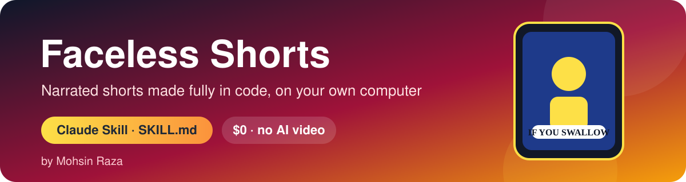
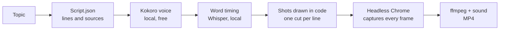

  

<h1 align="center">🎬 Faceless Shorts</h1>

  <b>Narrated faceless shorts, made fully in code on your own computer.</b> 
  Script, free local AI voice, word-synced captions, animation and MP4. No AI video, no API keys, no credits.

  
  
  
  

  
  
  

---

## 📖 Table of contents

- [What is this?](#-what-is-this)
- [See it in action](#-see-it-in-action)
- [The six styles](#-the-six-styles)
- [How it works](#-how-it-works)
- [Install](#-install)
- [Make a short](#-make-a-short)
- [Publish to YouTube (optional)](#-publish-to-youtube-optional)
- [Honest limits](#-honest-limits)
- [Contributing](#-contributing)
- [Author](#-author)
- [License](#-license)

---

## 🤔 What is this?

**Faceless Shorts** is a [Claude](https://claude.ai) skill (a folder with a `SKILL.md` file). Give it a topic, and it writes the script, records a narration with a free local voice, times every word for captions, draws the animated shots in code, adds sound and music, and renders a vertical MP4 for YouTube Shorts, TikTok or Reels.

Everything runs on your computer. Nothing is paid for, and no AI generates the images or video.

---

## 🎬 See it in action

A finished example made with the **Inside Out** style (36 seconds):

**▶ [samples/inside-out-sample.mp4](samples/inside-out-sample.mp4)**

> The sample was rendered without the Whisper model, so its caption timing is estimated. A normal setup gives exact word timing.

---

## 🎨 The six styles

| Style | What it makes | Length |
|---|---|---|
| **Deep Dive 3D** (`deep-dive`) | Flagship. Sculpted 3D people, glowing x-ray bodies, "What happens if…?" body and science | 30–45 s |
| **Night File 3D** (`night-file`) | Unsolved mysteries and true crime in dark 3D rooms | 30–45 s |
| **Inside Out** (`inside-out`) | Flat 2D x-ray explainers. The lightest and fastest style | 25–40 s |
| **Stick Story** (`stick-story`) | "What would you do if…?" survival steps | 30–45 s |
| **Paper Atlas** (`paper-atlas`) | History in cut paper, with maps and date ribbons | 30–45 s |
| **Tall Tale 3D** (`tall-tale`) | Funny true stories with cartoon people in a sunny 3D town | 40–60 s |

Each style has a style sheet image, a style guide (`STYLE.md`) and a finished example project in `styles/<style>/example/`.

---

## ⚙️ How it works

Claude also checks a **contact sheet** of the whole video before you see it, then fixes what it finds.

---

## 🚀 Install

You need: Node.js 22+, ffmpeg, Google Chrome and Python 3.10+. Claude installs what is missing and downloads about 1 GB of voice and caption models, once.

**Option 1: Claude.ai**
1. Download the latest zip from the [Releases](https://github.com/Mohsinraza23/faceless-shorts/releases) page, or use this repo's download.
2. In Claude's settings, open the skills section and upload the zip.

**Option 2: Claude Code**
1. Clone or download this repo into `~/.claude/skills/faceless-shorts/`.
2. Run `bash scripts/setup.sh` until it prints **All set**.
3. Run `bash scripts/selftest.sh` until it prints **SELFTEST PASSED**.
4. Start a new session and ask:

> Make a Deep Dive 3D short: what happens if you crack your knuckles?

**Windows:** run the scripts in Git Bash (it comes with Git for Windows).

---

## 🎯 Make a short

Tell Claude the topic, the style and the length. Claude then shows a one-screen plan (the narration, the shots and the sources) and waits for your **"Build it?"**. Only then does it build.

Good first topics:
- Inside Out: "What if you swallow gum?"
- Stick Story: "What would you do if the power went out for 3 days?"
- Paper Atlas: "How one bakery burned down London"

---

## 📺 Publish to YouTube (optional)

When you ask, Claude can upload the finished short to your channel through Zapier. Before anything is uploaded, Claude confirms the **title, visibility, category and the temporary host**. It never uploads without your approval.

- The video is first placed on a **temporary public host** that expires by itself, so YouTube can fetch it. Ask for the host to be changed if you do not want that.
- Check YouTube's current policy on **synthetic or altered content** before you publish. The narration is an AI voice, so you may need to set a disclosure.

---

## ⚠️ Honest limits

- **3D styles are slow without a graphics card.** One frame can take about 2 seconds, so a 40-second short may take a long time.
- **Captions depend on Whisper.** Without it, the words are spread evenly, so the timing is only estimated.
- **You check the facts.** Each script lists its sources in `script.json`. Claude tries to use good ones, but you should still check them before you publish.
- **The voices are English.** Check whether a voice fits your language before you use it for Urdu or Hindi narration.

---

## 🤝 Contributing

Ideas, bug reports and pull requests are welcome. Open an issue first for big changes. Keep the scripts simple (no new network calls without a reason), keep each style's example working, and run `selftest.sh` before you open a pull request.

---

## 👨‍💻 Author

Made by **Mohsin Raza**, the lead teacher of AI at the AI Summer Camp and creator of the Code With Mohsin channel.

  
  
  
  

---

## 📄 License

Released under the [MIT License](LICENSE). The code, stories, drawings and sound are original and free to use in your videos. Inter font: SIL Open Font License 1.1. Models installed on first use: Kokoro-82M (Apache-2.0), faster-whisper and Whisper small.en (MIT).

  ⭐ If this helped you, a star on the repo means a lot.

